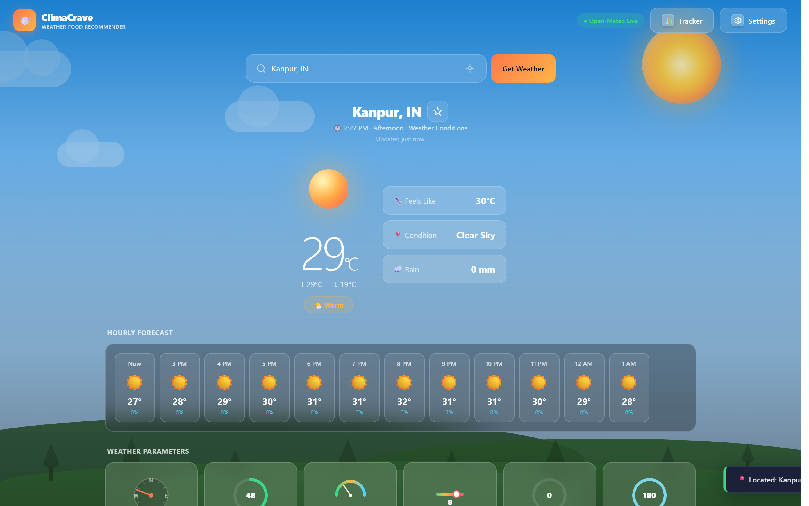
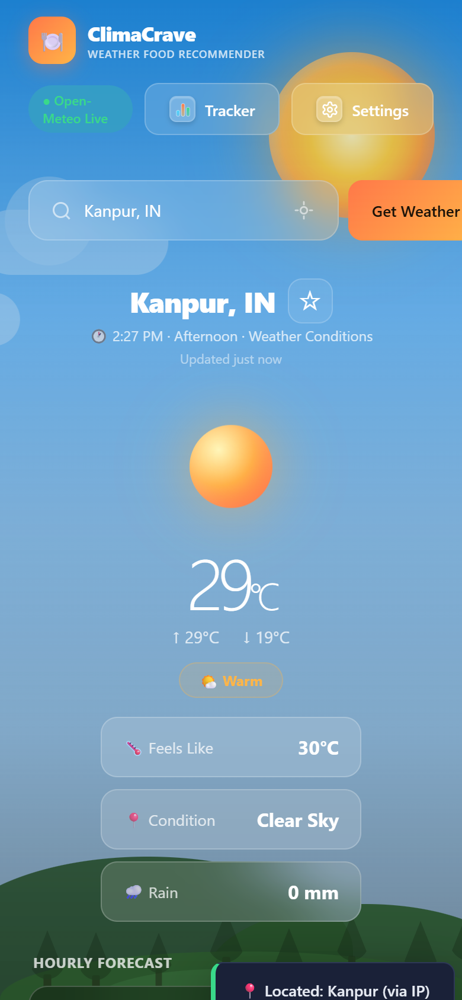
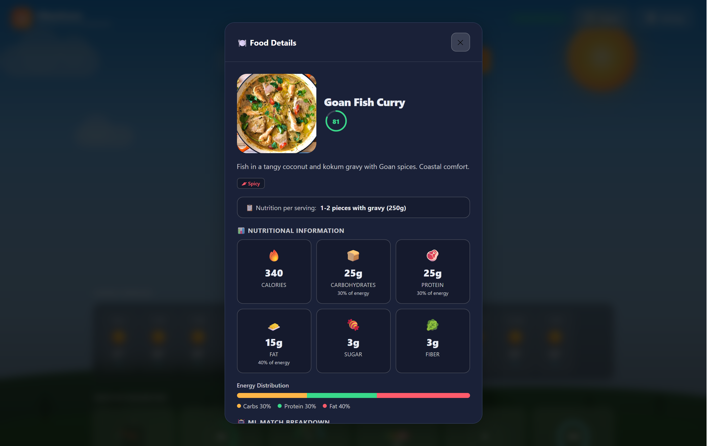
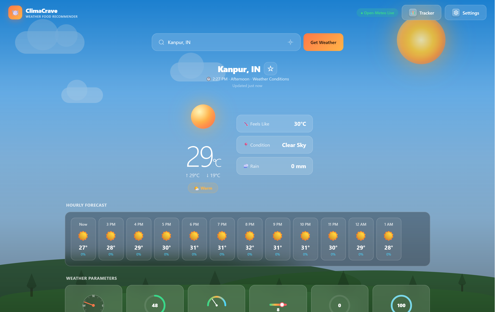
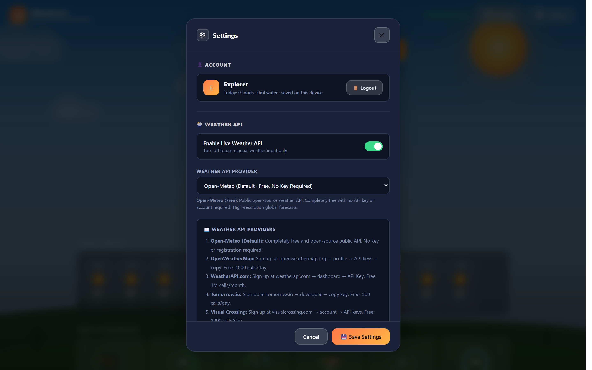
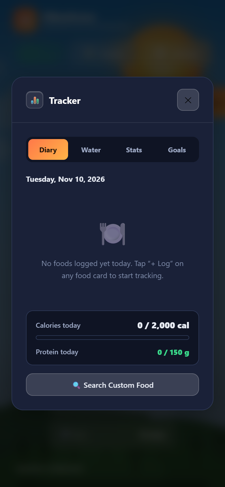
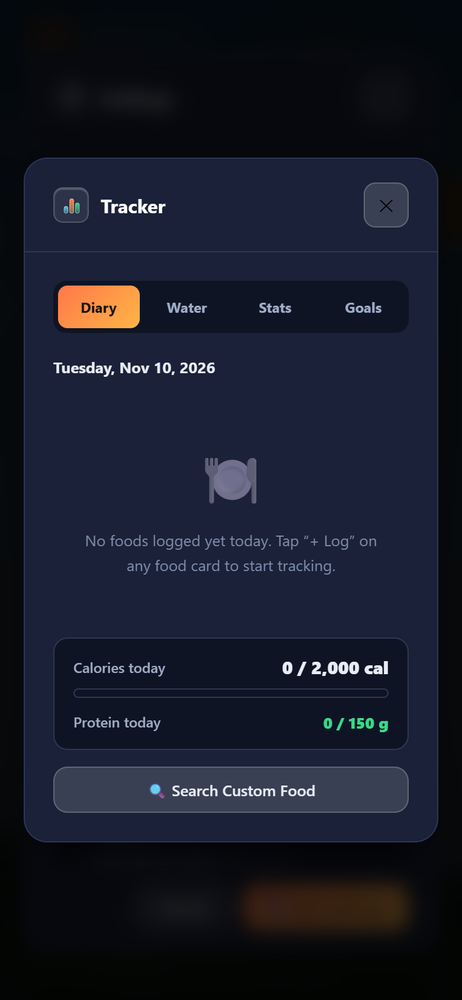

# ClimaCrave 🌤️🍽️
### Weather-Adaptive Food Recommendation System & Personal Nutrition Companion

[-orange?style=for-the-badge)](https://github.com/Lakshyadev247/ClimaCrave/releases)
[](https://github.com/Lakshyadev247/ClimaCrave/releases)
[](https://github.com/Lakshyadev247/ClimaCrave/releases)
[](LICENSE)
[](https://nodejs.org)
[](https://developer.mozilla.org)

> ⚠️ **Project Status: Public Beta (Active Testing & Development)**  
> ClimaCrave is currently in public Beta. It dynamically pairs atmospheric metrics (temperature, humidity, precipitation, and sky conditions) with smart food recommendations. Available as a **standalone Android APK**, **standalone Windows Desktop app**, or **local lightweight web app with zero external npm dependencies**. Community feedback and suggestions are warmly welcomed!

---

## 📸 UI Showcase (Desktop & Mobile)

| 💻 Windows Desktop (Standalone EXE) | 📱 Android Phone (Standalone APK) |
| :---: | :---: |
|  |  |
| *Live weather card, auto-location, and hybrid food recommendations* | *Touch-friendly mobile UI with glassmorphic bottom navigation* |

<details>
<summary><b>🔍 Click to view more screenshots (Food Details, Daily Tracker & Settings)</b></summary>

| Feature | Preview |
| :--- | :---: |
| **🍽️ Food Details & Nutritional Breakdown** |  |
| **📊 Food Diary & Daily Hydration Tracker** |  |
| **⚙️ Settings & Weather Provider Configuration** |  |
| **📱 Mobile Food Diary & Calorie Tracker Tab** |  |
| **📱 Mobile Saved Favorites & History Tab** |  |
| **📱 Mobile Settings & Clean Glass Controls** |  |

</details>

---

## 📖 The Story Behind ClimaCrave

Have you ever noticed how your appetite naturally changes with the weather? On a cold, rainy day, nothing beats a hot, steaming bowl of soup or spicy stew. On a sweltering summer afternoon, the last thing you want is a heavy roast; your body craves crisp salads, juicy fruits, and chilled hydration.

**ClimaCrave was born to bridge meteorology and gastronomy.**

Rather than flipping through generic food delivery apps or struggling to decide what to cook, ClimaCrave instantly reads your local atmospheric conditions — temperature, humidity, wind speed, and precipitation — and pairs them with an intelligent recommendation engine to serve up curated, satisfying food suggestions.

### What Makes ClimaCrave Special

- **Context-Aware Nutrition**: Recommends meals based on real-time atmospheric science and culinary comfort psychology.
- **Zero Configuration**: Uses the free, open-source Open-Meteo public API out of the box with zero API keys required.
- **Full Privacy & Local-First**: Works 100% locally with zero tracking. User accounts, settings, food diaries, and water logs are stored in your own local SQLite database or directly on your phone.
- **Runs Everywhere**: Use it as a clean local web app, a standalone native Windows desktop application, or an installable Android APK.

---

## 📥 Download Ready-to-Use Apps (No Setup Required!)

If you just want to run ClimaCrave on your computer or phone without touching code, download the pre-built packages directly from **[GitHub Releases](../../releases/latest)**:

| Platform | Download | Description |
| :--- | :--- | :--- |
| 📱 **Android** | [**`ClimaCrave.apk`**](../../releases/latest) | Standalone APK for Android phones & tablets (Target SDK 35). Runs **100% offline** with offline glassmorphism UI, bottom navigation bar, and zero external permissions. |
| 💻 **Windows Desktop** | [**`ClimaCrave.exe`**](../../releases/latest) | Portable single-executable desktop app powered by Microsoft WebView2. Clean execution with isolated `%APPDATA%\ClimateCrave\` data storage. |
| 📦 **Windows ZIP** | [**`ClimaCrave.zip`**](../../releases/latest) | Portable standalone desktop package in a portable archive. |

---

## 🌟 Key Features

* 🌦️ **Zero-Config Open-Meteo Public API**: Uses the free, open-source Open-Meteo public API out of the box with zero API keys required! Still supports OpenWeatherMap, WeatherAPI, Tomorrow.io, Visual Crossing, or custom APIs if desired.
* 📍 **Intelligent Auto-Location Detection**: Automatically detects your location on app launch (if no default city is set) or anytime by clicking the 📍 locate button. Uses browser Geolocation with reverse geocoding and an IP-based fallback if GPS is unavailable.
* 🧠 **Hybrid Adaptive Recommendation Engine**: Blends rule-based comfort heuristics with a local trained Machine Learning model (`ml/model.json`) evaluating temperature, humidity, wind, and sky conditions.
* 📊 **Comprehensive Wellness Tracking**:
  * 🥗 **Food Diary**: Log meals with calorie and nutrient breakdown.
  * 💧 **Water Tracker**: Real-time hydration monitoring with custom daily targets.
  * ⭐ **Saved Items**: Bookmark favorite meals and recipes for quick access.
  * 📜 **Weather History**: Track how weather patterns correlate with your dining habits over time.
* 💾 **Dual-Mode Persistence Architecture**: Local Node.js + SQLite (`climacrave.sqlite`) backend when available, with seamless client-side localStorage fallback when running standalone.
* 🎨 **Modern Glassmorphic UI**: High-contrast, clean visual design with responsive layouts across mobile, tablet, and desktop screens.

---

## ⚡ 1-Click Launchers (For Windows Users)

* **`start.bat`**: Double-click to launch ClimaCrave. It automatically verifies if Node.js is installed. If missing, it will **automatically download a portable Node.js runtime** from nodejs.org so anyone can run it without manual setup!
* **`stop.bat`**: Double-click to cleanly terminate all background server processes running on port 3000.

---

## 🏗️ Architecture Overview

```text
ClimaCrave/
├── index.html              # Core application entry point & semantic markup
├── css/
│   └── style.css           # Glassmorphism design system & responsive layout
├── js/
│   └── script.js           # Client application logic, recommendation engine & food database
├── ml/
│   ├── model.json          # Pre-trained weather-food scoring weights
│   ├── train_model.py      # Python model training script (scikit-learn / numpy)
│   └── README.md           # Machine learning documentation
├── screenshots/            # UI showcase gallery for desktop and mobile
├── server.js               # Zero-dependency Node.js server with native SQLite persistence
├── package.json            # Application metadata & engine specifications
├── requirements.txt        # Runtime and optional Python dependencies documentation
├── start.bat               # 1-click launcher with auto Node.js downloader
├── stop.bat                # 1-click server stopper
├── .gitignore              # Clean Git ignore rules (binaries & temp files excluded)
├── .gitattributes          # Git line ending normalization
├── LICENSE                 # MIT Open-Source License
└── README.md               # Master documentation
```

### Technical Highlights
1. **Frontend**: Plain HTML5, CSS3, and modern Vanilla JavaScript (ES6+). Zero heavy frontend frameworks means instant cold-starts and low memory usage.
2. **Backend**: Node.js 22.5+ utilizing the native `node:sqlite` engine. Requires **zero external npm packages** (`npm install` is not even needed).
3. **Database**: SQLite stores user accounts (hashed credentials), preferences, food diary entries, water tracking, and weather logs.
4. **Desktop Wrapper**: Standalone Windows executable packaged with embedded WebView2 runtime for native app performance.
5. **Mobile Build**: Android APK built for modern devices (Target SDK 35) with optimized mobile touch navigation and glass popups.

---

## 🚀 Developer Quick Start Guide

### Prerequisites
* **[Node.js 22.5+](https://nodejs.org/)** (Uses Node's built-in `node:sqlite`, zero npm dependencies required!)
* Any modern web browser (Edge, Chrome, Firefox, Safari)

---

### Option A: 1-Click Launch (Windows)
Simply double-click **`start.bat`**.
- Automatically checks for Node.js (or downloads portable runtime).
- Boots the server on port 3000.
- Opens `http://localhost:3000` in your browser.

---

### Option B: Command Line (Windows, macOS, Linux)
1. Clone the repository:
   ```bash
   git clone https://github.com/Lakshyadev247/ClimaCrave.git
   cd ClimaCrave
   ```

2. Start the local server:
   ```bash
   node server.js
   ```

3. Open your browser and navigate to:
   ```text
   http://localhost:3000
   ```

---

## 🤖 Retraining the ML Model (Optional)

If you wish to experiment with or retrain the weather-food recommendation model:

```bash
# 1. Create a Python virtual environment (optional)
python -m venv .venv
source .venv/bin/activate  # On Windows: .venv\Scripts\activate

# 2. Install Python dependencies
pip install -r requirements.txt

# 3. Run the training script
python ml/train_model.py
```
This updates `ml/model.json` with new weight vectors for temperature, humidity, wind, and sky condition scores.

---

## 🤝 Contributing & Feedback

Contributions, suggestions, and issue reports are very welcome!

1. **Fork the Repository**
2. **Create your Feature Branch** (`git checkout -b feature/AmazingFeature`)
3. **Commit your Changes** (`git commit -m "Add AmazingFeature"`)
4. **Push to the Branch** (`git push origin feature/AmazingFeature`)
5. **Open a Pull Request**

---

## 📄 License

Distributed under the **MIT License**. See [`LICENSE`](LICENSE) for more details.

---

## 🙏 Acknowledgements

* [Open-Meteo](https://open-meteo.com/) for providing high-accuracy, free public weather APIs.
* [Microsoft Edge WebView2](https://developer.microsoft.com/en-us/microsoft-edge/webview2/) for lightweight native desktop application embedding.
* The open-source community for making local-first software possible.
