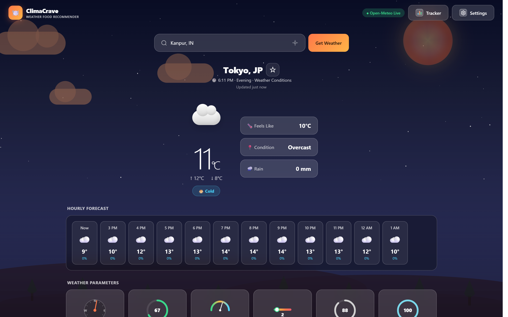
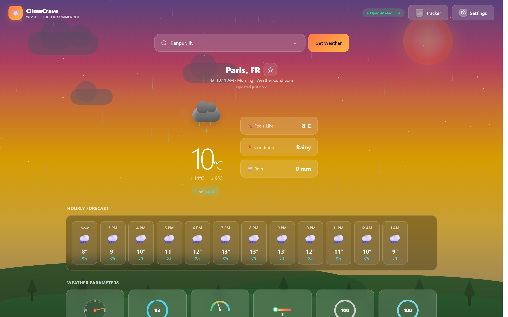
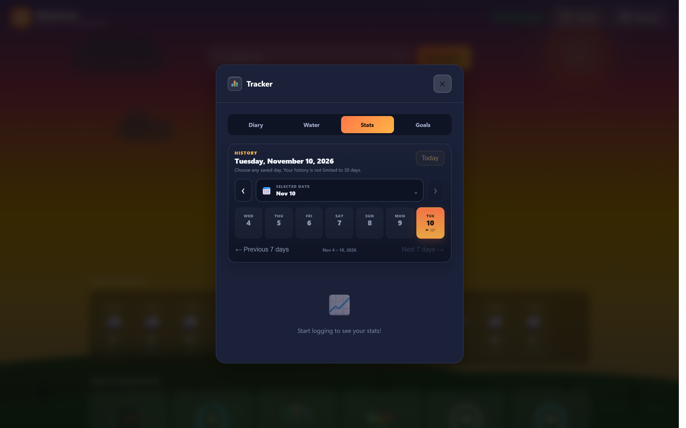
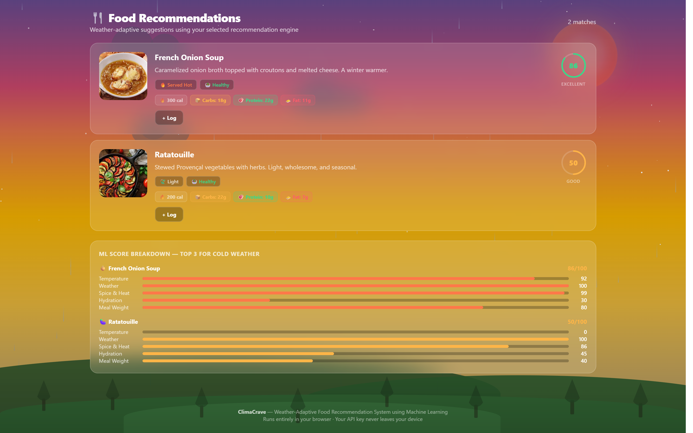

# ClimaCrave 🌤️🍽️
### Weather-Adaptive Food Recommendation System & Personal Nutrition Companion

[](https://github.com/Lakshyadev247/ClimaCrave/releases)
[](https://github.com/Lakshyadev247/ClimaCrave/releases)
[](https://github.com/Lakshyadev247/ClimaCrave/releases)
[](LICENSE)
[](https://nodejs.org)
[](https://developer.mozilla.org)

> ⚠️ **Project Status: Public Beta (v1.0.0-Beta)**  
> ClimaCrave is currently in public Beta. It bridges real-time atmospheric meteorology with culinary science to solve mealtime decision fatigue. Whether you're experiencing a chilly rainy evening or a scorching summer afternoon, ClimaCrave suggests the most appetitive, nourishing meals tailored to your local environment.

---

## 💡 Why ClimaCrave? The Problem It Solves & Why It's Helpful

Have you ever stood in front of your fridge or scrolled through endless food delivery menus, completely unable to decide what to eat? 

**Decision fatigue around food is real.** But more importantly, our cravings and physiological dietary needs are profoundly tied to the atmospheric conditions outside:

1. **Cold, Rainy & Chilly Weather**: Your body expends more energy to maintain core body temperature. It naturally craves warming, calorie-dense comfort foods — steaming broths, hearty stews, roasted root vegetables, and hot spiced teas.
2. **Hot & Scorching Weather**: High temperatures suppress digestion and increase perspiration. Heavy, greasy foods make you feel sluggish and overheated. Your body craves light, hydrating meals — chilled salads, water-dense fruits, yogurt bowls, and cold refreshments.
3. **High Humidity & Overcast Days**: Humid air slows sweat evaporation, making metabolism feel heavy. Nutrient-dense, easily digestible meals with clean antioxidants help maintain energy and focus.

**ClimaCrave automates this entire decision process.** Instead of guessing, ClimaCrave instantly reads your live local weather and curates appetizing, nutritious meal recommendations that suit your current climate. 

Furthermore, ClimaCrave unifies your wellness routine by replacing 3–4 separate apps with one lightweight, private platform:
* 🌦️ **Live Weather Station** (Real-time temperature, humidity, precipitation, and conditions).
* 🍽️ **Smart Food Recommendation Engine** (Hybrid rule-based + ML scoring).
* 🥗 **Interactive Food Diary** (Calorie logging, macro tracking, and portion controls).
* 💧 **Hydration Tracker** (1-tap water intake logs and daily goal rings).
* 📜 **Weather-Nutrition Correlation History** (Track how local weather patterns impact your eating habits).

---

## 📸 Desktop UI Showcase

| 🌃 1. Night Time Weather & Sky (Tokyo) | 🌅 2. Evening / Sunset Sky (Paris) |
| :---: | :---: |
|  |  |
| *Deep starry night sky with glowing moon & live night weather card* | *Warm golden-hour sunset gradient with evening atmospheric metrics* |

| 🔍 3. Food Diary Custom Search | 📊 4. Daily Stats (Food & Water Logged) |
| :---: | :---: |
|  |  |
| *Instant food search with calorie count, macro cards & 1-click logging* | *Comprehensive nutrition summary: total calories, macros & water ring* |

### 🍽️ 5. City-Adaptive Food Recommendations

*Curated recommendation cards tailored to the current city's weather, complete with food photos, heat tags, and nutritional breakdown.*

---

## 🌟 Comprehensive Feature Breakdown

### 🌦️ 1. Zero-Config Weather Engine
* **Open-Meteo Integration**: Uses the free, open-source Open-Meteo public API out of the box with **zero API keys or configuration required**.
* **Intelligent Auto-Location**: Detects your location on launch with 1-click GPS Geolocation, reverse geocodes the city name, and falls back to IP-based location if GPS is unavailable.
* **Favorite City Bookmark (☆)**: Bookmark any city in the world as your default location for instant weather on launch.
* **Alternative Provider Support**: Seamlessly switch to OpenWeatherMap, WeatherAPI, Tomorrow.io, Visual Crossing, or custom API endpoints in Settings if you prefer your own keys.

### 🧠 2. Hybrid Recommendation Engine (Rules + Machine Learning)
* **Multi-Factor Atmospheric Analysis**: Evaluates 4 distinct weather variables:
  * 🌡️ **Temperature**: Ranks hot comfort soups vs chilled refreshing items.
  * 💧 **Humidity**: Adjusts hydration scores and heavy/light digestive balance.
  * 🌧️ **Precipitation**: Triggers rainy-day comfort food heuristics (pakoras, hot stews, tea).
  * ☁️ **Sky Condition**: Calibrates energizing vs cozy comfort meals.
* **Embedded Machine Learning Model (`ml/model.json`)**: Employs a pre-trained decision scoring matrix that evaluates meal compatibility scores alongside dietary rules.

### 🎨 3. Dynamic Atmospheric Sky Themes
* **Time-of-Day Gradients**: Real-time atmospheric color transitions reflecting:
  * 🌅 **Morning**: Warm peach-to-cyan sunrise hues.
  * ☀️ **Afternoon**: Crisp blue daylight sky or warm heatwave glow.
  * 🌆 **Evening**: Rich golden-hour purple-pink sunset.
  * 🌃 **Night**: Deep midnight indigo canvas with twinkling stars and moon.

### 🥗 4. Food Diary & Interactive Nutrition Search
* **Built-in Multi-Cuisine Food Database**: Pre-loaded with hundreds of popular meals across Indian, Asian, and Continental cuisines.
* **Live Custom Food Search**: Type any ingredient or dish name to pull up instant nutritional profiles (calories, protein, carbohydrates, and fats).
* **Flexible Portion Controls**:
  * 🥣 **By Portion**: 0.5x, 1x, 1.5x, 2x multipliers.
  * ⚖️ **By Grams**: Granular gram adjustment with +/- buttons.
  * ⚡ **Quick Presets**: 1 Bowl (150g), 1 Plate (200g), 1 Katori (100g), 1 Glass (250ml).

### 💧 5. Daily Hydration Tracker
* **1-Tap Quick Logs**: Log water effortlessly with buttons for `+1 Glass (250ml)`, `+500ml`, and `+1 Bottle (1L)`.
* **Visual Progress Ring**: Live percentage completion bar toward your custom daily water target.

### 💾 6. Dual-Mode Local-First Persistence
* **Zero-Dependency SQLite Backend**: When running with the included Node.js server, data is saved in a local `climacrave.sqlite` database using Node 22's native `node:sqlite` engine (**zero npm packages to install**).
* **Client-Side Fallback**: If running without a server (standalone HTML/APK), it automatically uses device `localStorage`.
* **100% Privacy Focused**: No telemetry, no third-party tracking, and no external accounts. Your personal wellness logs stay on your device.

---

## 📥 Download Ready-to-Use Apps (No Setup Required!)

Download pre-built standalone packages directly from **[GitHub Releases](../../releases/latest)**:

| Platform | Package | Description |
| :--- | :--- | :--- |
| 📱 **Android** | [**`ClimaCrave.apk`**](../../releases/latest) | Standalone APK for Android phones & tablets (Target SDK 35). Runs **100% offline** with bottom glass navigation and zero external permissions. |
| 💻 **Windows Desktop** | [**`ClimaCrave.exe`**](../../releases/latest) | Portable single-executable desktop app powered by Microsoft WebView2. Clean execution with isolated `%APPDATA%\ClimateCrave\` data storage. |
| 📦 **Windows ZIP** | [**`ClimaCrave.zip`**](../../releases/latest) | Portable standalone desktop package in a portable archive. |

---

## ⚡ 1-Click Launchers (For PC Users & Developers)

* **`start.bat`**: Double-click to start ClimaCrave. It automatically verifies if Node.js is installed. If missing, it will **automatically download a portable Node.js runtime** from nodejs.org so anyone can run it with one click!
* **`stop.bat`**: Double-click to cleanly terminate all background server processes running on port 3000.

---

## 🚀 Running From Source (Step-by-Step)

### Prerequisites
* **[Node.js 22.5+](https://nodejs.org/)** (Uses Node's built-in `node:sqlite`, zero npm dependencies required!)
* Any modern web browser (Edge, Chrome, Firefox, Safari)

### Quick Start
```bash
# 1. Clone the repository
git clone https://github.com/Lakshyadev247/ClimaCrave.git
cd ClimaCrave

# 2. Start the local server
node server.js

# 3. Open in your browser
# Navigate to http://localhost:3000
```

*(Or simply double-click **`start.bat`** on Windows!)*

---

## 🤖 Retraining the ML Model (Optional)

If you wish to experiment with or retrain the weather-food recommendation model:

```bash
# 1. Install optional Python requirements
pip install -r requirements.txt

# 2. Run the training script
python ml/train_model.py
```
This updates `ml/model.json` with new weight vectors for temperature, humidity, wind, and sky condition scores.

---

## 🤝 Contributing & Community Help

* Found an issue or have an idea for a feature? Open an issue on the [Issues](../../issues) tab!
* Pull requests are warmly welcomed.

---

## 📄 License

Distributed under the **MIT License**. See [`LICENSE`](LICENSE) for details.

---

## 🙏 Acknowledgements

* [Open-Meteo](https://open-meteo.com/) for free, high-accuracy public weather APIs.
* [Microsoft Edge WebView2](https://developer.microsoft.com/en-us/microsoft-edge/webview2/) for lightweight desktop application embedding.
* The open-source community for making local-first software possible.
