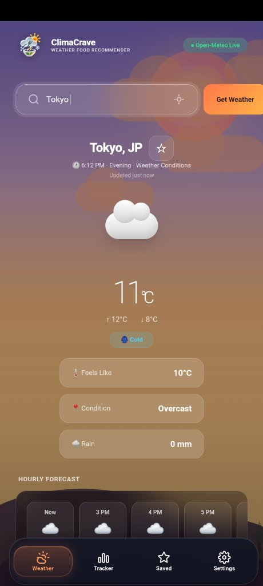
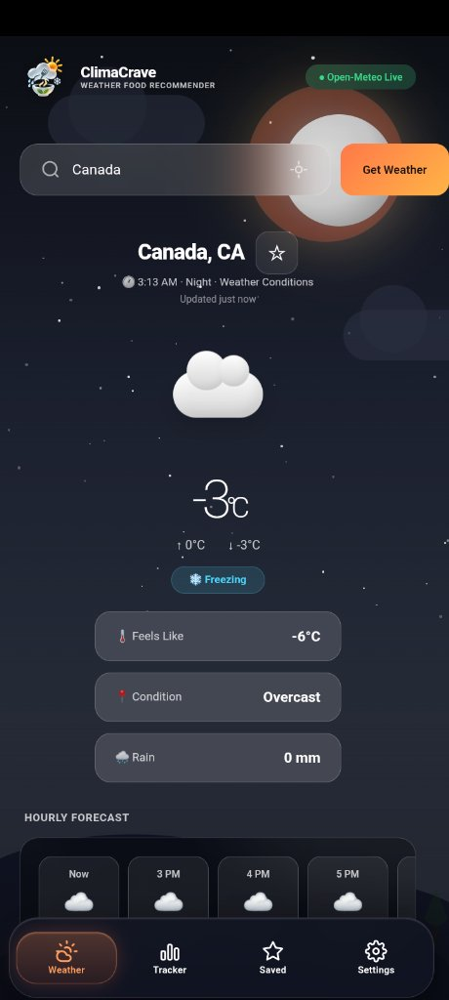
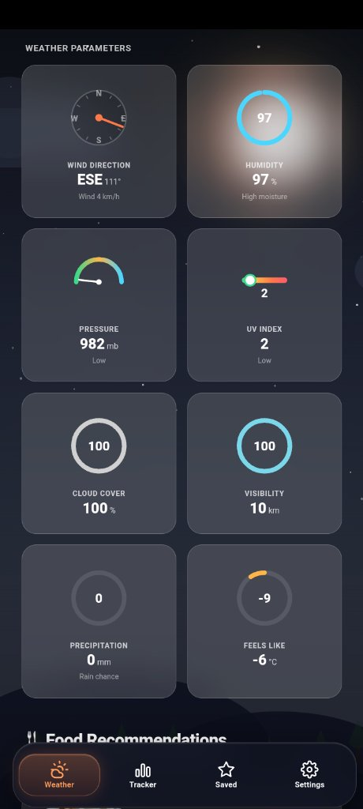
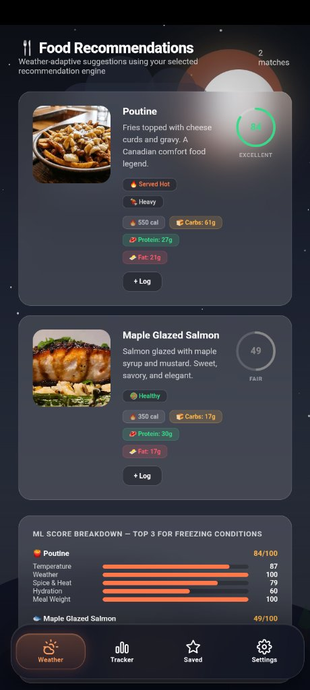
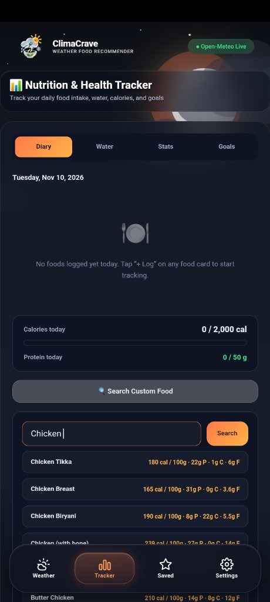
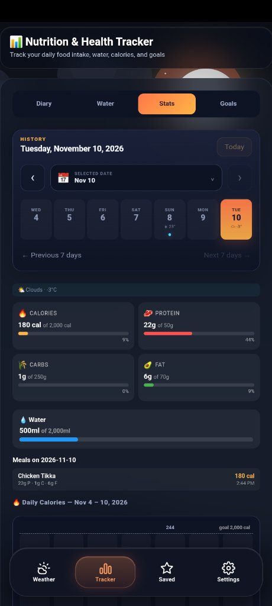
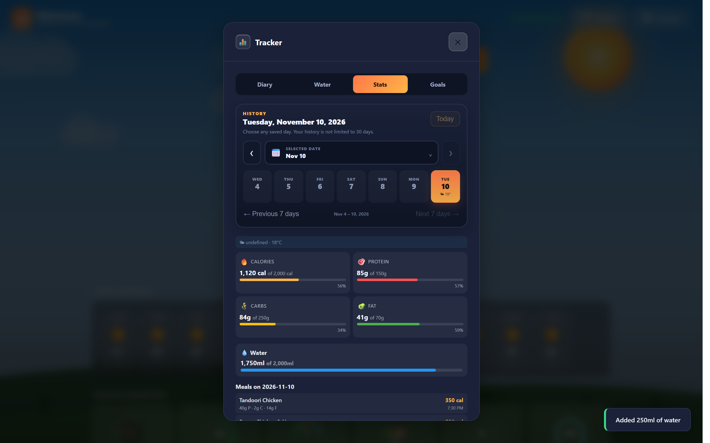

# ClimaCrave 🌤️🍽️
### Weather-Adaptive Food Recommendation System & Personal Nutrition Companion

[](https://github.com/Lakshyadev247/ClimaCrave/releases)
[](https://github.com/Lakshyadev247/ClimaCrave/releases)
[](https://github.com/Lakshyadev247/ClimaCrave/releases)
[](https://developer.mozilla.org)
[-brightgreen?style=for-the-badge)](https://github.com/Lakshyadev247/ClimaCrave)
[](https://github.com/Lakshyadev247/ClimaCrave)
[](LICENSE)

> ⚠️ **Project Status: Public Beta (v1.0.0-Beta)**  
> ClimaCrave is a lightweight, zero-dependency weather-adaptive food recommendation system. It bridges real-time atmospheric meteorology with culinary science to solve mealtime decision fatigue. Whether you are facing a chilly overcast evening or a scorching summer afternoon, ClimaCrave analyzes temperature, humidity, precipitation, and conditions to suggest the most appetitive, nourishing meals for your body.

---

## 📸 UI Showcase (Desktop & Mobile)

### 📱 Android Phone (Standalone APK)

| 🌃 Night Weather (Tokyo) | ❄️ Freezing Weather (Canada) | 📊 Detailed Parameters |
| :---: | :---: | :---: |
|  |  |  |
| *Tokyo evening overcast & glass navigation* | *Canada -3°C freezing conditions* | *Humidity, pressure, UV, & visibility* |

| 🍽️ Food Recommendations | 🔍 Food Diary (Chicken Search) | 📈 Daily Nutrition Stats |
| :---: | :---: | :---: |
|  |  |  |
| *Poutine & ML score breakdown* | *Instant multi-cuisine search for Chicken* | *Calories, macros, & hydration log* |

---

### 💻 Windows Desktop (Standalone EXE)

| 🌃 Night Time Weather & Sky (Tokyo) | 🌅 Evening / Sunset Sky (Paris) |
| :---: | :---: |
|  |  |
| *Deep starry night sky with glowing moon* | *Warm golden-hour sunset gradient* |

| 🔍 Food Diary Custom Search | 📊 Daily Stats (Food & Water Logged) |
| :---: | :---: |
|  |  |
| *Instant search with calorie counts & macros* | *Comprehensive nutrition summary & water ring* |

| 🍽️ City-Adaptive Food Recommendations |
| :---: |
|  |
| *Curated recommendation cards tailored to city weather conditions* |

---

## 💡 Why ClimaCrave? The Problem It Solves & Why It's Helpful

Have you ever stood in front of your fridge or scrolled through endless food delivery menus, completely unable to decide what to eat? 

**Decision fatigue around food is real.** But more importantly, our cravings and physiological dietary needs are deeply connected to the weather outside:

* ❄️ **Cold, Freezing & Chilly Weather**: Your body expends more energy to maintain core temperature. It naturally craves warming, calorie-dense comfort foods — steaming broths, hearty stews, roasted dishes, and thermogenic spices.
* ☀️ **Hot & Scorching Weather**: High temperatures suppress digestive fire and increase perspiration. Heavy foods make you feel sluggish and overheated. Your body craves light, hydrating meals — chilled salads, water-dense fruits, yogurt bowls, and cold refreshments.
* 🌧️ **Rainy, Humid & Overcast Days**: Slower sweat evaporation makes metabolism feel heavy. Nutrient-dense, easily digestible meals with clean antioxidants and warm herbal infusions help maintain energy and focus.

**ClimaCrave automates this entire decision process.** Instead of guessing or settling for random junk food, ClimaCrave reads your live local weather and curates appetizing, nutritious meal recommendations that suit your current climate.

Furthermore, ClimaCrave unifies your wellness routine by replacing 3–4 separate apps with one lightweight, private platform:
1. 🌦️ **Live Weather Station**: Real-time temperature, humidity, precipitation, wind, UV index, and atmospheric metrics.
2. 🍽️ **Smart Food Recommendation Engine**: Hybrid rule-based heuristics blended with local Machine Learning scoring.
3. 🥗 **Interactive Food Diary**: Calorie logging, macronutrient breakdown (protein, carbs, fat), and flexible portion sizing.
4. 💧 **Hydration Tracker**: 1-tap water intake logs and daily goal rings.
5. 📜 **Weather-Nutrition Correlation History**: Track how weather patterns correlate with your daily nutrition.

---

## 🌟 Comprehensive Feature Breakdown

### 🌦️ 1. Zero-Config Weather Engine
* **Open-Meteo Integration**: Uses the free, open-source Open-Meteo public API out of the box with **zero API keys or configuration required**.
* **Intelligent Auto-Location**: Detects your location on launch with 1-click GPS Geolocation, reverse geocodes the city name, and falls back to IP-based location if GPS is unavailable.
* **Favorite City Bookmark (☆)**: Bookmark any city in the world as your default location for instant weather on launch.
* **Alternative Provider Support**: Seamlessly switch to OpenWeatherMap, WeatherAPI, Tomorrow.io, Visual Crossing, or custom API endpoints in Settings if you prefer your own keys.

### 🧠 2. Hybrid Recommendation Engine (Rules + Machine Learning)
* **Multi-Factor Atmospheric Analysis**: Evaluates 4 distinct atmospheric dimensions:
  * 🌡️ **Temperature**: Ranks hot comfort soups vs chilled refreshing items.
  * 💧 **Humidity**: Adjusts hydration scores and heavy/light digestive balance.
  * 🌧️ **Precipitation**: Triggers rainy-day comfort food heuristics (pakoras, hot stews, tea).
  * ☁️ **Sky Condition**: Calibrates energizing vs cozy comfort meals.
* **Embedded Machine Learning Model (`ml/model.json`)**: Employs a pre-trained decision scoring matrix that evaluates meal compatibility scores alongside dietary rules.

### 🎨 3. Dynamic Atmospheric Sky Themes
* **Time-of-Day Gradients**: Real-time atmospheric color transitions reflecting:
  * 🌅 **Morning**: Warm peach-to-cyan sunrise hues.
  * ☀️ **Afternoon**: Crisp blue daylight sky or warm heatwave glow.
  * 🌆 **Evening**: Rich golden-hour purple-pink sunset.
  * 🌃 **Night**: Deep midnight indigo canvas with twinkling stars and moon.

### 🥗 4. Food Diary & Interactive Nutrition Search
* **Built-in Multi-Cuisine Food Database**: Pre-loaded with hundreds of popular meals across Indian, Asian, and Continental cuisines.
* **Live Custom Food Search**: Type any ingredient or dish name (e.g. *chicken*, *paneer*, *salad*) to pull up instant nutritional profiles (calories, protein, carbohydrates, and fats).
* **Flexible Portion Controls**:
  * 🥣 **By Portion**: 0.5x, 1x, 1.5x, 2x multipliers.
  * ⚖️ **By Grams**: Granular gram adjustment with +/- buttons.
  * ⚡ **Quick Presets**: 1 Bowl (150g), 1 Plate (200g), 1 Katori (100g), 1 Glass (250ml).

### 💧 5. Daily Hydration Tracker
* **1-Tap Quick Logs**: Log water effortlessly with buttons for `+1 Glass (250ml)`, `+500ml`, and `+1 Bottle (1L)`.
* **Visual Progress Ring**: Live percentage completion bar toward your custom daily water target.

### 💾 6. 100% Local-First & Private Persistence
* **Zero npm Packages Required**: The entire web app runs purely on browser standards.
* **Browser LocalStorage**: Works out of the box with zero database setup required.
* **Optional Node.js + SQLite Backend**: For users who want a local desktop database file, an optional `server.js` using Node's native `node:sqlite` is included.
* **100% Privacy Focused**: No telemetry, no third-party tracking, and no external accounts. Your personal wellness logs stay on your device.

---

## 📥 Download Ready-to-Use Apps (No Setup Required!)

Download pre-built standalone packages directly from **[GitHub Releases](../../releases/latest)**:

| Platform | Package | Description |
| :--- | :--- | :--- |
| 📱 **Android** | [**`ClimaCrave.apk`**](../../releases/latest) | Standalone APK for Android phones & tablets (Target SDK 35). Runs **100% offline** with bottom glass navigation and zero external permissions. |
| 💻 **Windows Desktop** | [**`ClimaCrave.exe`**](../../releases/latest) | Portable single-executable desktop app powered by Microsoft WebView2. Clean execution with isolated `%APPDATA%\ClimateCrave\` data storage. |
| 📦 **Windows ZIP** | [**`ClimaCrave.zip`**](../../releases/latest) | Portable standalone desktop package in a portable archive. |

---

## ⚡ How to Run

### Method 1: Instant Browser Launch (Zero Installation Required!)
Simply double-click **`index.html`** in any web browser (Chrome, Edge, Firefox, Brave, Safari).
* 0 installations needed.
* 0 npm commands needed.
* 0 server configuration needed.
* Everything works immediately using browser local storage!

---

### Method 2: 1-Click Windows Launcher
Double-click **`start.bat`** on Windows.
* Opens ClimaCrave directly in a dedicated desktop window.
* When finished, double-click **`stop.bat`** to exit.

---

### Method 3: Optional Local Node Server (For Developers)
If you wish to use the optional local SQLite database backend:
```bash
node server.js
```
Then open `http://localhost:3000`. Zero external npm packages required!

---

## 🏗️ Architecture Overview

```text
ClimaCrave/
├── index.html              # Pure HTML5 application entry point
├── css/
│   └── style.css           # Glassmorphism design system & responsive layout
├── js/
│   └── script.js           # Vanilla JavaScript app logic, weather engine & food database
├── ml/
│   ├── model.json          # Pre-trained weather-food scoring weights
│   ├── train_model.py      # Optional Python model training script (scikit-learn / numpy)
│   └── README.md           # Machine learning documentation
├── server.js               # Optional local server with native SQLite persistence
├── package.json            # Application metadata
├── requirements.txt        # Runtime & optional Python dependencies notes
├── start.bat               # 1-click launcher for Windows
├── stop.bat                # 1-click stopper for Windows
├── .gitignore              # Clean Git ignore rules (binaries & media excluded)
├── .gitattributes          # Git line ending normalization
├── LICENSE                 # MIT Open-Source License
└── README.md               # Master documentation
```

---

## 🤖 Retraining the ML Model (Optional)

If you wish to experiment with or retrain the weather-food recommendation model:

```bash
# 1. Install optional Python requirements
pip install -r requirements.txt

# 2. Run the training script
python ml/train_model.py
```
This updates `ml/model.json` with new weight vectors for temperature, humidity, wind, and sky condition scores.

---

## 🤝 Contributing & Community Help

* Found an issue or have an idea for a feature? Open an issue on the [Issues](../../issues) tab!
* Pull requests are warmly welcomed.

---

## 📄 License

Distributed under the **MIT License**. See [`LICENSE`](LICENSE) for details.

---

## 🙏 Acknowledgements

* [Open-Meteo](https://open-meteo.com/) for free, high-accuracy public weather APIs.
* [Microsoft Edge WebView2](https://developer.microsoft.com/en-us/microsoft-edge/webview2/) for lightweight desktop application embedding.
* The open-source community for making local-first software possible.
